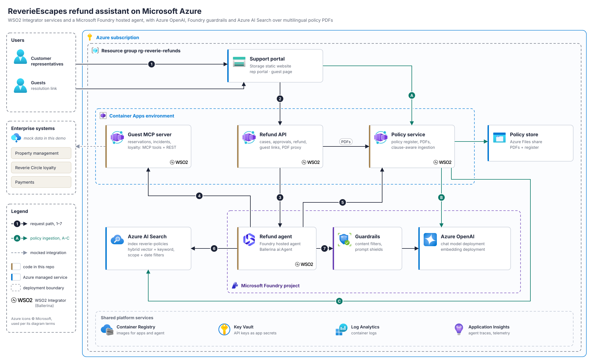
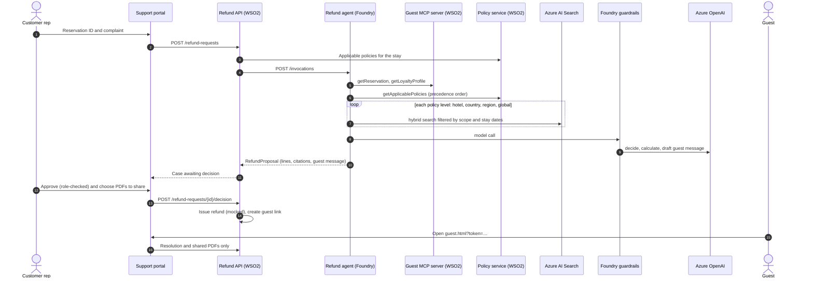

# ReverieEscapes refund assistant

A demo of WSO2 and Microsoft Azure working together to run an AI agent in production.

ReverieEscapes Hotels & Resorts runs 29 hotels in 18 countries across Europe, Africa, the Americas and
Asia-Pacific. Its refund rules are layered:

- a global policy;
- regional and country addenda;
- hotel rules;
- seasonal protocols that apply only inside their date window.

These rules are written in five languages.

A customer representative logs a guest's complaint in the support portal. A Ballerina agent hosted in
Microsoft Foundry reads the stay, the incident log and every policy in force for those nights, using
Azure AI Search over the policy PDFs. It then recommends a refund, calculated night by night, with every
clause cited and a guest message in the guest's own language.

The representative approves or rejects the recommendation. Only then is the refund paid, by WSO2
Integrator code rather than by the agent. The guest gets a private page with the decision and the
policy PDFs it relied on.

## Deployment architecture



The diagram has two paths. The request path (numbered, dark) handles a refund case:

| Step | What happens |
|---|---|
| 1 | A representative opens the support portal. Guests open their resolution page from the same site. |
| 2 | The portal calls the refund API. |
| 3 | The refund API invokes the refund agent in Foundry over the invocations protocol. |
| 4 | The agent reads the reservation, incident log and loyalty tier through MCP tools on the guest MCP server. |
| 5 | The agent asks the policy service which documents apply to the stay, in order of precedence. |
| 6 | The agent searches Azure AI Search once per policy level, filtered by the stay's hotel, country, region and dates. |
| 7 | Model calls pass through Foundry guardrails to Azure OpenAI, which reasons over the passages and writes the guest message. |

The ingestion path (lettered, green) keeps the index up to date:

| Step | What happens |
|---|---|
| A | A policy administrator uploads a PDF in the portal's policy library. The policy service stores it on the Azure Files share. |
| B | The policy service chunks the PDF by clause and embeds the chunks with the Azure OpenAI embedding deployment. |
| C | The policy service writes the chunks, with their scope and date metadata, to the Azure AI Search index. |

The refund API also reads policy PDFs from the policy service, to serve the documents shared with a guest.

The Foundry guardrail screens both the model calls and the agent endpoint: content filters, and prompt
shields against jailbreaks and instructions injected into documents. A jailbreak attempt in a complaint
is blocked before the agent runs. It is configured in Foundry, so the agent code doesn't change.

Boundaries in the diagram:

- **Users** and the **enterprise systems** are outside Azure. The guest MCP server stands in for the
  property management, loyalty and payment systems with mock data.
- Everything in the **resource group** is deployed by you:
  - the three WSO2 Integrator services in one **Container Apps environment**;
  - the agent, guardrails and model deployments in a **Microsoft Foundry project**;
  - the AI Search index;
  - shared platform services.

The diagram is generated from [docs/architecture/build_diagram.py](docs/architecture/build_diagram.py)
(`python3 build_diagram.py`); [deployment.png](docs/architecture/deployment.png) is a 2× render for
slides. The Azure icons are Microsoft's official architecture icons, used under
Microsoft's terms for architecture diagrams. The WSO2 logo is WSO2's mark.

### Request flow



## What is in this repository

Each folder has its own README with its endpoints, configuration and design notes.

The Ballerina code is in two WSO2 Integrator workspaces, each a folder with a `Ballerina.toml` that
lists its packages:

- [backends](backends) holds the three integration services: `guest_mcp_server`, `policy_service` and
  `refund_api`;
- [agents](agents) holds the agents; today that is `refund_agent`.

`bal build` in a workspace folder builds all its packages. Every package follows the WSO2 Integrator
project layout, so it opens in the WSO2 Integrator extension with its services, connections, functions
and agents in the standard files (`main.bal`, `config.bal`, `connections.bal`, `types.bal`, `functions.bal`,
`data_mappings.bal`, `agents.bal`, `automation.bal`).

| Folder | What it is | Port |
|---|---|---|
| [backends/guest_mcp_server](backends/guest_mcp_server) | Mock reservation and loyalty systems: MCP tools at `/mcp`, REST at `/api`. | 9090 |
| [backends/policy_service](backends/policy_service) | Policy register, PDF hosting, applicable-policy resolution and the RAG ingestion pipeline. | 8090 |
| [backends/policy_service/policies](backends/policy_service/policies) | The policy store: 14 policy PDFs, their HTML sources, the register and the PDF build script. | — |
| [backends/refund_api](backends/refund_api) | Cases, re-assessment, role-gated decisions, the refund, guest links and the PDF proxy. | 8080 |
| [agents/refund_agent](agents/refund_agent) | The refund agent: a Ballerina `ai:Agent` served through `azure:FoundryListener` as a Foundry hosted agent. | 8088 |
| [portal](portal) | Support portal and guest resolution page; static files, no build step. | 8000 |
| [docs](docs) | The [runbook](docs/deploy-and-test.md) and the deployment diagram with its generator and icons. | — |

## Policy documents

The register is [backends/policy_service/policies/register.json](backends/policy_service/policies/register.json). Precedence, from most to least
specific (clauses GLB-2.1 to GLB-2.5):

- hotel rules, then country addenda, then regional addenda, then the global policy;
- a seasonal document applies only to nights in its window, and prevails over base documents of the
  same or broader scope;
- the original-language version is authoritative.

| Document | Language | Scope | Type | In force |
|---|---|---|---|---|
| GLB-RF-2026 Global Guest Refund and Compensation Policy | English | Global | Base | from 1 Jan 2026 |
| GLB-LC-2026 Reverie Circle Loyalty Service Recovery Policy | English | Global | Base | from 1 Jan 2026 |
| EU-RF-2026 Europe Regional Refund Addendum | English | Europe | Base | from 1 Jan 2026 |
| AF-RF-2026 Africa Regional Refund Addendum | English | Africa | Base | from 1 Mar 2026 |
| AM-RF-2026 Americas Regional Refund Addendum | English | Americas | Base | from 1 Jan 2026 |
| AP-RF-2026 Asia-Pacific Regional Refund Addendum | English | Asia-Pacific | Base | from 1 Jan 2026 |
| DE-RF-2026 Länderergänzung Deutschland | German | Germany | Base | from 1 Jan 2026 |
| ES-RF-2026 Anexo nacional España | Spanish | Spain | Base | from 1 Jan 2026 |
| FR-PAR-OPE-2026 Règlement de l'établissement — Paris Opéra | French | Hotel PAR-OPE | Base | from 1 Feb 2026 |
| JP-KYO-GIO-2026 京都祇園 返金・補償に関する施設規程 | Japanese | Hotel KYO-GIO | Base | from 1 Jan 2026 |
| SEA-EU-SUMMER-2026 Europe Summer Peak and Heat Protocol | English | Europe | Seasonal | 15 Jun – 15 Sep 2026 |
| SEA-AM-HURRICANE-2026 Atlantic Hurricane Season Guest Policy | English | Americas | Seasonal | 1 Jun – 30 Nov 2026 |
| SEA-JP-KYO-AUTUMN-2026 京都祇園 秋の観光繁忙期 特別規程 | Japanese | Hotel KYO-GIO | Seasonal | 25 Oct – 10 Dec 2026 |
| SEA-ZA-GRID-2026 South Africa Grid Emergency Compensation Protocol | English | South Africa | Seasonal | 1 Oct – 31 Dec 2026 |

The last one is not in the register. It sits in [backends/policy_service/policies/demo-upload](backends/policy_service/policies/demo-upload) so you can
upload it live during the demo. To change a document, edit its HTML in
[backends/policy_service/policies/source](backends/policy_service/policies/source) and run
`backends/policy_service/policies/build-pdfs.sh <documentId>`, which uses headless
Chrome.

## The RAG pipeline

The policy service turns each PDF into search-ready chunks
([backends/policy_service/functions.bal](backends/policy_service/functions.bal)):

1. **Load.** `ai:TextDataLoader` extracts the PDF text.
2. **Normalise.**
   - Running footers and page numbers are dropped.
   - Line breaks are unwrapped into paragraphs: CJK text is joined without spaces, and letter-spaced
     headings are closed up.
   - Headings and clause IDs count only when they continue the document's own numbering, so a wrapped
     "2026." is never read as a new section.
3. **Chunk by structure.**
   - Each clause (`GLB-5.1`, `KYO-2.1`, …) is a unit, and stays with its section.
   - Units are packed up to `maxChunkChars`. Oversized clauses are split by sentence, or on 。 for
     Japanese.
4. **Add context.** Every chunk starts with a header line naming the document, version, scope, type,
   effective window, language and section. The embedding then knows that a Japanese passage is the
   Kyoto Gion autumn rule.
5. **Attach metadata as index fields:** `scope`, `region`, `countryCode`, `hotelId`, `policyType`,
   `language`, `effectiveFrom`/`effectiveTo` (yyyymmdd integers), `section` and `clauseIds`.
6. **Re-index idempotently.**
   - Chunk keys are stable (`{documentId}_{n}`).
   - A document's old chunks are deleted before the new ones are uploaded.
   - Unchanged PDFs (same SHA-256) are skipped.
   - The state is kept in `backends/policy_service/policies/.index-state.json`, which is git-ignored.

At query time the agent never lets the model choose the scope. Its tools load the reservation
themselves. They then run one Azure AI Search query per policy level (hotel, country, region, global),
each filtered to the stay's hotel, country or region and to documents in force on those nights. A French
hotel rule or a Japanese seasonal rule is therefore never crowded out by English global passages. The
multilingual embedding model matches English questions to passages in any language.

A new seasonal policy goes live without a redeploy: upload the PDF in the policy library (or
`POST /policies`), and it is stored, added to the register and indexed. The next assessment of a stay
inside its window picks it up.

## Run locally

[docs/deploy-and-test.md](docs/deploy-and-test.md) has the full runbook: creating the Azure OpenAI and
AI Search resources with the CLI, generating the `Config.toml` files, testing each service, and then
deploying everything to Azure. The short version follows.

Prerequisites:

- Ballerina Swan Lake Update 14 (2201.14.x).
- `ballerinax/ai.azure` 1.6.0 or later, the first version with `azure:FoundryListener`. Until it is
  published to Ballerina Central, build
  [module-ballerinax-ai.azure](https://github.com/ballerina-platform/module-ballerinax-ai.azure) locally
  so the package is in your local repository.
- An Azure OpenAI resource with a chat model deployment and an embedding deployment (for example
  `text-embedding-3-small`).
- An Azure AI Search service and its admin key (both the policy service and the agent use it).
- Python 3, to serve the portal.

Build both workspaces once, from the repository root:

```bash
(cd backends && bal build) && (cd agents && bal build)
```

Then start the services in this order, each in its own terminal, from the repository root. Each
`Config.toml.template` lists its settings; copy it to `Config.toml` (git-ignored) in the same folder
and fill it in.

1. Guest MCP server:

   ```bash
   cd backends/guest_mcp_server && bal run
   ```

2. Policy service. Copy `Config.toml.template` to `Config.toml` with the Azure OpenAI and AI Search
   settings, then:

   ```bash
   cd backends/policy_service && bal run
   ```

3. Index the 13 registered policies (once; later runs skip unchanged PDFs):

   ```bash
   curl -X POST http://localhost:8090/policies/ingest
   ```

4. Refund agent. Copy `Config.toml.template` to `Config.toml`, then run it. It connects to the MCP
   server at startup, so start it after step 1.

   ```bash
   cd agents/refund_agent && bal run
   ```

5. Refund API (the defaults match this setup):

   ```bash
   cd backends/refund_api && bal run
   ```

6. Portal, then open <http://localhost:8000>:

   ```bash
   python3 -m http.server 8000 --bind 127.0.0.1 --directory portal
   ```

The portal finds the APIs through [portal/config.js](portal/config.js). Without Azure settings, the
policy service still serves the register, the PDFs and the chunk previews (`GET /policies/{id}/chunks`);
only indexing is disabled.

## Demo script

The portal's **New request** page has a card for each of the eight reservations, grouped by region, with
the guest's complaint ready to submit. The demo date is 14 November 2026, which matters for the 30-day
rule and the seasonal windows.

| Reservation | Hotel | What the policies give |
|---|---|---|
| RES-PAR-24117 | Paris Opéra 🇫🇷 | French hotel rules: façade-works noise 15% on 2 nights, hot water 40% on 1 night, highest single rate per night → **EUR 294.00**; Gold 7,500 points; guest message in English. |
| RES-KYO-31842 | Kyoto Gion 🇯🇵 | Japanese autumn seasonal rule replaces the hotel's base rate: public bath closed 2 nights at 25% → **JPY 49,000**, within the seasonal JPY 90,000 limit; Platinum 10,000 points; message in Japanese. |
| RES-CPT-50391 | Cape Town 🇿🇦 | Africa addendum: load-shedding 20% × 3 nights → **ZAR 2,880**; Gold 7,500 points; message in German. |
| RES-MIA-77120 | Miami Beach 🇺🇸 | Hurricane season policy: resort fee waived 3 days, 20% for the warning night, 50% for the outage night → **USD 407.30**; Silver 2,000 points; message in Spanish. |
| RES-BER-60455 | Berlin Mitte 🇩🇪 | German addendum: heating failure 60% plus pro-rata city tax → **EUR 135.45**; Classic, no points; message in French. |
| RES-BCN-41208 | Barcelona Gòtic 🇪🇸 | Spanish addendum: terrace noise after 23:00, 25% × 2 → **EUR 130.00**; Silver 2,000 points; message in Italian. |
| RES-NYC-80233 | New York Midtown 🇺🇸 | No incident logged → **no refund** (GLB-4.3). |
| RES-SIN-90017 | Singapore Marina 🇸🇬 | Checked out in August, more than 30 days ago → **no refund** (GLB-4.1). |

These are the outcomes the documents are written to produce. The model writes each proposal, so check
the figures on the day.

A suggested flow, about ten minutes:

1. **Region switcher.** Show the hotel network, then filter the queue to Asia-Pacific and back.
2. **Kyoto.** Submit the Kyoto case. In the case view, point out:
   - the policy stack, with the Japanese seasonal rule on top;
   - the calculation lines and the Japanese clauses cited, summarised in English;
   - the guest message drafted in Japanese.
3. **Cape Town, before the upload.** Submit the Cape Town case (ZAR 2,880 under AF-2.1).
4. **Upload the seasonal policy.** In **Policy library**:
   - upload `backends/policy_service/policies/demo-upload/SEA-ZA-GRID-2026.pdf` with the values from
     `SEA-ZA-GRID-2026.metadata.json`;
   - open **Preview chunks** to show the clause-aware chunks and their context headers;
   - point out the new bar on the season timeline.
5. **Cape Town, after the upload.** Back on the case, select **Re-assess with latest policies**. The new
   recommendation is ZAR 5,760 under ZAG-2.1 with doubled points, and the history shows both
   assessments.
6. **Approve and share.**
   - Switch the role to see approval gating.
   - Approve, choosing which PDFs to share with the guest.
   - Open the guest page: it is in German, with the policy PDFs it relied on.

Uploading the protocol adds it to the policy register, copies the PDF into the policy store, and
indexes its chunks. To reset the demo, undo all three, as described in
[the policies README](backends/policy_service/policies/README.md#reset-after-the-demo): the agent filters search by scope and
dates, so chunks left in the index would still be found.

## Deploy to Azure

Follow [docs/deploy-and-test.md](docs/deploy-and-test.md#part-3-deploy-to-azure). It deploys what the
diagram shows, using the Azure CLI and the Foundry REST API:

- the three WSO2 Integrator services on Azure Container Apps, from their Dockerfiles, with the policies
  folder on a mounted Azure Files share;
- the refund agent as a Foundry hosted agent on the `invocations` protocol, with its keys in a Foundry
  project connection;
- the portal as a static website on the storage account;
- Foundry guardrails on the model deployment and the agent endpoint.

Every service has a Dockerfile that runs its `bal build` jar on `eclipse-temurin:25-jre`, configured
through `BAL_CONFIG_VAR_<NAME>` environment variables. The backend images run as a non-root user. The
agent uses the Dockerfile the WSO2 Integrator extension generates for Foundry, which also bundles an
OpenTelemetry Collector that sends the agent's traces to Application Insights.

## Limits of the demo

- Azure OpenAI and Azure AI Search are reached with API keys; the module does not yet support managed
  identity.
- The refund API keeps cases in memory, and the refund and the guest email are logged, not sent.
- The guest MCP server serves fixed mock data for the eight reservations.
- CORS is open on every service so the static portal can call them; restrict it in a real deployment.
- The services, portal and guest page have been tested together against a stub agent. The agent and
  ingestion have not been run against Azure.
