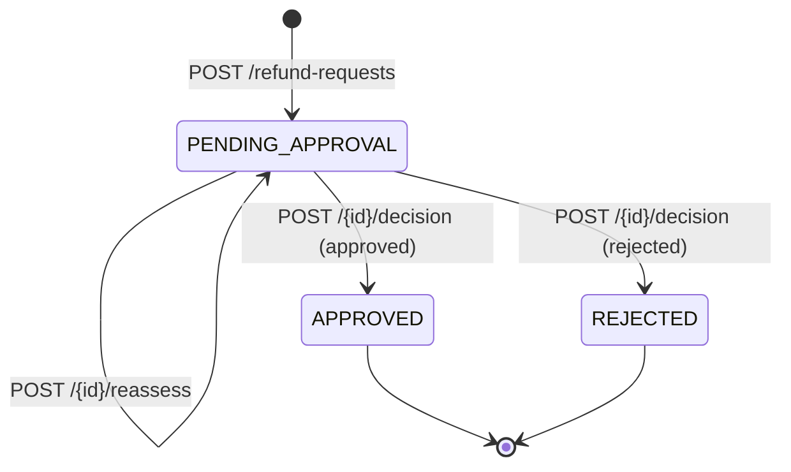

# Refund API

The refund API is the WSO2 Integrator (Ballerina) service that owns refund cases. The
[support portal](../../portal) calls it to create a case from a guest's complaint. The API then invokes the
[refund agent](../../agents/refund_agent/refund_agent) for a recommendation, records the representative's decision and issues the
refund. It also creates the guest's private share link and serves the guest resolution page and the policy
PDFs shared with the guest. The agent only recommends: money moves only here, in plain integration code,
and only after an approval from a role with enough authority. See the [main README](../../README.md) for the
whole demo and the deployment diagram.

| Calls | For |
|---|---|
| [agent](../../agents/refund_agent/refund_agent) `POST /invocations` | A `RefundProposal` for a reservation and complaint. |
| [guest-mcp-server](../guest_mcp_server) REST API (`/api`) | The reservation snapshot, regions and hotels. |
| [policy-service](../policy_service) | The policies in force for the stay, and the PDFs for the guest. |

It does not call Azure directly. In the Azure deployment it runs on Azure Container Apps and reaches the
Foundry-hosted agent with a Microsoft Entra access token.

## Case lifecycle



1. **Create.** The API loads the reservation from the guest API and the applicable policies from the
   policy service. It then invokes the agent and stores the case as `PENDING_APPROVAL` with the proposal.
2. **Re-assess.** Only while the case is pending. The API fetches the policies again and re-runs the agent.
   The previous proposal moves to `proposalHistory`, so a policy uploaded since the first assessment
   shows up as a second, different recommendation.
3. **Decide.** The representative approves or rejects. Approving needs a role at or above the
   proposal's `approvalLevel`. On approval of a `REFUND` proposal, the API issues the refund (mocked) and
   creates the guest share. A decided case cannot be re-assessed or decided again (`409 Conflict`).

### Approval levels

The agent sets `approvalLevel` from the policy thresholds. The decision request names the acting `role`,
and the API compares ranks:

| Role | Rank | Can approve proposals at |
|---|---|---|
| `REPRESENTATIVE` | 1 | `REPRESENTATIVE` |
| `DUTY_MANAGER` | 2 | `REPRESENTATIVE`, `DUTY_MANAGER` |
| `REGIONAL_DIRECTOR` | 3 | any level |

Any role can reject. An approval below the required level returns `403 Forbidden`:

```json
{"message": "Approving this case needs duty manager authority or above; the representative role cannot approve it."}
```

The role is taken from the request body as given. The portal's role switcher sets it; there is no
authentication in the demo.

### Guest share

A share is created when a case is approved, or when it is rejected with an edited `guestMessage`. A
rejection without a message creates no share.

- The token is a random UUID without hyphens, and the link is `{portalUrl}/guest.html?token={token}`.
- `sharePolicyIds` picks which PDFs the guest may open. Only IDs that are in the case's
  `applicablePolicies` are kept; others are dropped silently.
- `guestMessage` replaces the agent's subject and body. The language stays the agent's.
- The guest email is not sent: the API logs `Guest notification queued` with the address, language and
  link.

## Endpoints

Default base URL: `http://localhost:8080`. All bodies are JSON, except the PDF proxy.

| Method and path | What it does | Responses |
|---|---|---|
| `GET /health` | Status and the number of cases in memory. | 200 |
| `GET /regions` | Proxies the guest API's regions. | upstream status, 502 |
| `GET /hotels?region=&countryCode=` | Proxies the guest API's hotels, optionally filtered. | upstream status, 502 |
| `GET /reservations/{id}` | Proxies one reservation from the guest API. | upstream status, 502 |
| `POST /refund-requests` | Creates a case and runs the first assessment. | 201, 400, 404, 502 |
| `GET /refund-requests?region=&countryCode=&hotelId=&status=` | Lists cases, newest first, with optional filters. | 200 |
| `GET /refund-requests/{id}` | One case, by its `id` (not its case number). | 200, 404 |
| `POST /refund-requests/{id}/reassess` | Re-runs the agent on a pending case. | 200, 404, 409, 502 |
| `POST /refund-requests/{id}/decision` | Approves or rejects; pays and shares on approval. | 200, 403, 404, 409 |
| `GET /guest/resolutions/{token}` | The guest's view of the case: no internal reasoning, only shared PDFs. | 200, 404 |
| `GET /guest/resolutions/{token}/documents/{documentId}` | Streams a shared policy PDF from the policy service. | 200, 404, 502 |

Errors have the body `{"message": "..."}`. A `502 Bad Gateway` means the guest API, the policy service or
the agent failed; the message says which.

### Create a case

Request (`channel` is one of `PHONE`, `EMAIL`, `FRONT_DESK`, `CHAT`; it defaults to `PHONE`, and
`createdBy` to `Guest Relations`):

```json
{
  "reservationId": "RES-CPT-50391",
  "complaint": "The power was off every evening and the generator did not cover our room.",
  "channel": "PHONE",
  "createdBy": "Amelia Hart"
}
```

Response, `201 Created` (shortened):

```json
{
  "id": "3f58f5c3-ef1b-471d-a0a7-caaa56bb84f2",
  "caseNumber": "RC-2026-0001",
  "createdAt": "2026-11-14T05:56:19.720255Z",
  "updatedAt": "2026-11-14T05:56:19.720255Z",
  "createdBy": "Amelia Hart",
  "channel": "PHONE",
  "reservationId": "RES-CPT-50391",
  "complaint": "The power was off every evening ...",
  "reservation": {"reservationId": "RES-CPT-50391", "hotel": {"hotelId": "CPT-WAT", "region": "AFRICA", "...": "..."}, "guest": {"...": "..."}, "checkIn": "2026-10-20", "checkOut": "2026-10-24", "nights": 4},
  "status": "PENDING_APPROVAL",
  "proposal": {
    "reservationId": "RES-CPT-50391",
    "decision": "REFUND",
    "refundAmount": 2880.00,
    "currency": "ZAR",
    "refundAmountUsd": 159.12,
    "bonusPoints": 7500,
    "approvalLevel": "REPRESENTATIVE",
    "lines": [{"date": "2026-10-20", "description": "Load-shedding ...", "clauseId": "AF-2.1", "percentage": 20, "amount": 960.00}],
    "citations": [{"documentId": "AF-RF-2026", "clauseId": "AF-2.1", "language": "en", "summary": "..."}],
    "reasoning": "...",
    "guestMessage": {"language": "de", "subject": "...", "body": "..."}
  },
  "proposalHistory": [],
  "applicablePolicies": [{"documentId": "AF-RF-2026", "title": "...", "titleEnglish": "...", "language": "en", "scope": "...", "policyType": "...", "effectiveFrom": "2026-03-01", "precedence": 3}]
}
```

`proposal.decision` is `REFUND`, `NO_REFUND` or `NEEDS_MORE_INFO`. After a re-assessment each
`proposalHistory` entry is `{"assessedAt": "...", "proposal": {...}}`. After a decision the case also has
`decision`, `refundId` (when a refund was paid) and `guestShare`.

### Decide

```json
{
  "approved": true,
  "decidedBy": "Amelia Hart",
  "role": "DUTY_MANAGER",
  "note": "Checked with the hotel.",
  "sharePolicyIds": ["AF-RF-2026", "GLB-RF-2026"],
  "guestMessage": {"subject": "...", "body": "..."}
}
```

`note`, `sharePolicyIds` (default `[]`) and `guestMessage` are optional. The response is the updated case,
with:

```json
{
  "status": "APPROVED",
  "decision": {"approved": true, "decidedBy": "Amelia Hart", "role": "DUTY_MANAGER", "note": "Checked with the hotel.", "decidedAt": "..."},
  "refundId": "RF-5256375B",
  "guestShare": {"token": "55533b6a...", "url": "http://localhost:8000/guest.html?token=55533b6a...", "sharedAt": "...", "policyIds": ["AF-RF-2026", "GLB-RF-2026"], "message": {"language": "de", "subject": "...", "body": "..."}}
}
```

### Guest resolution

`GET /guest/resolutions/{token}` returns only what the guest should see:

```json
{
  "caseNumber": "RC-2026-0001",
  "guestName": "...",
  "preferredLanguage": "de",
  "hotel": {"name": "...", "city": "Cape Town", "countryName": "South Africa", "countryCode": "ZA"},
  "stay": {"checkIn": "2026-10-20", "checkOut": "2026-10-24", "nights": 4, "roomType": "Harbour View King"},
  "outcome": "REFUND_APPROVED",
  "refund": {"amount": 2880.00, "currency": "ZAR"},
  "bonusPoints": 7500,
  "message": {"language": "de", "subject": "...", "body": "..."},
  "decidedAt": "...",
  "policies": [{"documentId": "AF-RF-2026", "title": "...", "titleEnglish": "...", "language": "en", "scope": "...", "policyType": "...", "effectiveFrom": "2026-03-01", "effectiveTo": null, "documentUrl": "/guest/resolutions/55533b6a.../documents/AF-RF-2026"}]
}
```

`outcome` is:

- `REFUND_APPROVED` for an approved `REFUND` proposal; only then are `refund` and `bonusPoints` (otherwise
  `0`) filled in;
- `NO_REFUND` for an approved `NO_REFUND` or `NEEDS_MORE_INFO` proposal;
- `UNDER_REVIEW` for a rejected case that was shared with an edited message.

`documentUrl` is relative to the refund API. The PDF proxy returns `404` for any document not in the
share, even one in the case's applicable policies, and serves the PDF inline as
`application/pdf`.

## Configuration

Every setting is optional; the defaults match the local setup in the [main README](../../README.md#run-locally).
To change one, copy [Config.toml.template](Config.toml.template) to `Config.toml` (git-ignored), or set
`BAL_CONFIG_VAR_<NAME>` (for example `BAL_CONFIG_VAR_AGENTURL`).

| Name | Default | Meaning |
|---|---|---|
| `port` | `8080` | HTTP port of this service. |
| `agentUrl` | `http://localhost:8088` | Base URL of the refund agent, or of the Foundry agent endpoint. |
| `agentInvocationsPath` | `/invocations` | Path appended to `agentUrl`. It may carry a query string (for example an `api-version`); the session parameter is added with `&`. |
| `agentAccessToken` | not set | Microsoft Entra access token, sent as `Authorization: Bearer ...` to an agent deployed to Foundry. Leave unset for the local agent. |
| `agentSessionId` | empty | Session ID sent to the agent. Empty uses the case ID, so Foundry starts a sandbox per case; a fixed value such as `refund-api` reuses one warm sandbox. |
| `guestApiUrl` | `http://localhost:9090/api` | REST API of the guest MCP server. |
| `policyServiceUrl` | `http://localhost:8090` | Policy service, for applicable policies and PDFs. |
| `portalUrl` | `http://localhost:8000` | Base URL of the portal; guest links point to `{portalUrl}/guest.html?token=...`. |

## Run it

Start the guest MCP server, the policy service and the refund agent first (see the
[main README](../../README.md#run-locally)). Then, from the repository root:

```bash
cd backends/refund_api
```

```bash
bal run
```

The package is a member of the backends workspace ([backends/Ballerina.toml](../Ballerina.toml)),
so `bal build` in `backends/` builds it together with the other backend services. `bal build`
in this folder builds only this package, into `target/bin/refund_api.jar`, which the
[Dockerfile](Dockerfile) packages.

The API itself needs no Azure settings. Creating or re-assessing a case does, through the agent.

## Example calls

Check that it is up:

```bash
curl http://localhost:8080/health
```

Create a case (this waits for the agent, which can take a minute):

```bash
curl -X POST http://localhost:8080/refund-requests -H 'Content-Type: application/json' -d '{"reservationId":"RES-CPT-50391","complaint":"The power was off every evening.","channel":"PHONE","createdBy":"Amelia Hart"}'
```

List pending cases in Africa:

```bash
curl 'http://localhost:8080/refund-requests?region=AFRICA&status=PENDING_APPROVAL'
```

Re-assess a case with the latest policies, using the `id` from the create response:

```bash
curl -X POST http://localhost:8080/refund-requests/<CASE_ID>/reassess
```

Approve it and share two PDFs with the guest:

```bash
curl -X POST http://localhost:8080/refund-requests/<CASE_ID>/decision -H 'Content-Type: application/json' -d '{"approved":true,"decidedBy":"Amelia Hart","role":"DUTY_MANAGER","sharePolicyIds":["AF-RF-2026","GLB-RF-2026"]}'
```

Open the guest view and one shared PDF, using `guestShare.token` from the decision response:

```bash
curl http://localhost:8080/guest/resolutions/<TOKEN>
```

```bash
curl -o AF-RF-2026.pdf http://localhost:8080/guest/resolutions/<TOKEN>/documents/AF-RF-2026
```

## Design notes

- **Cases are in memory.** Cases, share tokens and the case-number sequence are lost on restart. Case
  numbers are `RC-{year}-{nnnn}`, counted from 1 in each run.
- **The case keeps a reservation snapshot.** The reservation types are open records, so fields this
  service does not read (rates, incidents, room number) stay in the case as the guest API returned them.
- **The API fetches applicable policies itself**, separately from the agent. They drive the policy stack
  in the case view and limit which PDFs can be shared.
- **The case `id` is the agent session.** Every invocation sends `agent_session_id={caseId}`, so a
  re-assessment runs in the same Foundry session as the first assessment. The HTTP timeout to the agent
  is 180 seconds, because one assessment makes several model and tool calls.
- **No double payment.** The decision sets the status inside a lock before the refund is issued, so a
  second decision gets `409`. A re-assessment that finishes after a decision is discarded with `409`.
- **The refund is mocked.** `issueRefund` in [functions.bal](functions.bal) logs `Refund issued` and returns
  an `RF-` ID; replace it with the payment and loyalty system calls. The refund is issued only for an
  approved `REFUND` proposal.
- **Guests see only what was shared.** The resolution leaves out the reasoning, lines and citations, and
  the PDF proxy checks each document against the share, so the policy service never has to be public.
- **CORS is open** (`*`, `GET`/`POST`/`OPTIONS`, `Content-Type`) so the static portal can call it.
  Restrict it in a real deployment.

## Files

The package follows the WSO2 Integrator project layout: each kind of construct has its own file at the
package root.

| File | What it holds |
|---|---|
| [main.bal](main.bal) | The HTTP service and its listener (port `port`, 240 s request timeout) with its CORS config. |
| [config.bal](config.bal) | Every configurable: port, agent URL, path, token and session, guest API, policy service and portal URLs. |
| [connections.bal](connections.bal) | HTTP clients for the agent (180 s timeout), the guest API and the policy service. |
| [types.bal](types.bal) | Case, proposal, decision, share and guest resolution types, and the `NotFoundError` error type. |
| [functions.bal](functions.bal) | The in-memory store, guest API and policy service calls, the agent invocation, the guest API proxy, the mocked refund, the guest share, case numbers, approval ranks and small query, time and response helpers. |
| [data_mappings.bal](data_mappings.bal) | `toGuestResolution`: maps a case to the guest's resolution view. |
| [agents.bal](agents.bal) | Empty: this service defines no agent (it calls the one in [agent](../../agents/refund_agent/refund_agent)). |
| [automation.bal](automation.bal) | Empty: there is no main function or scheduled job. |
| [Config.toml.template](Config.toml.template) | All settings with their defaults. |
| [Ballerina.toml](Ballerina.toml) | Package `reverie_escapes/refund_api` ("Refund API"), Ballerina 2201.14.1, sticky dependency versions. |
| [Dockerfile](Dockerfile) | Container image for the built `refund_api.jar`. |
